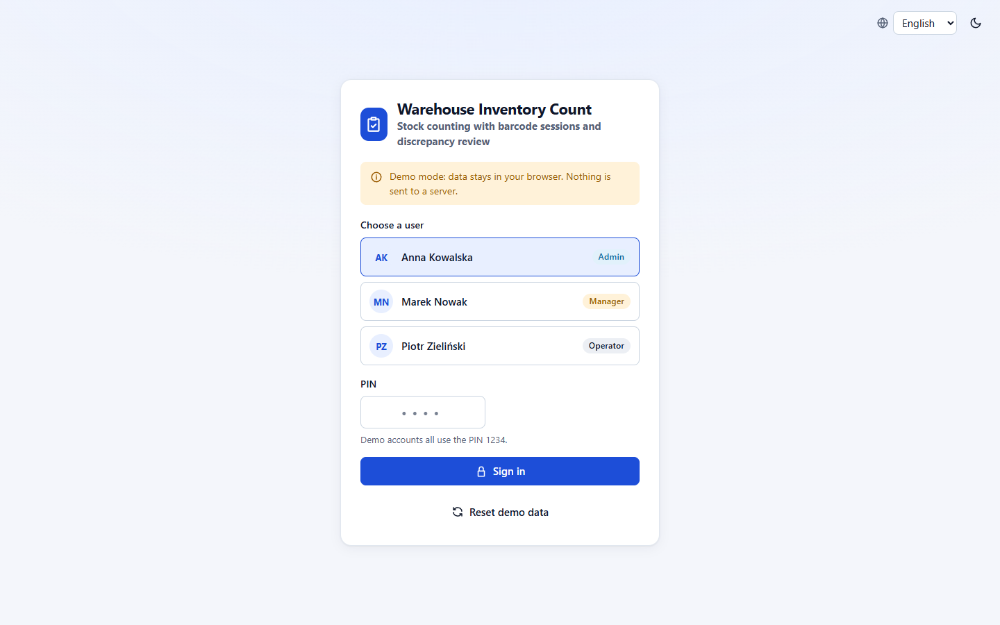
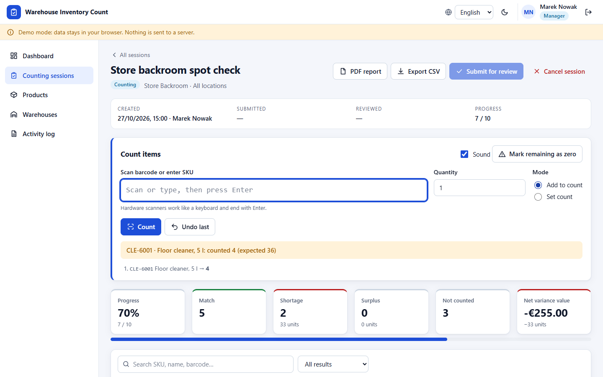
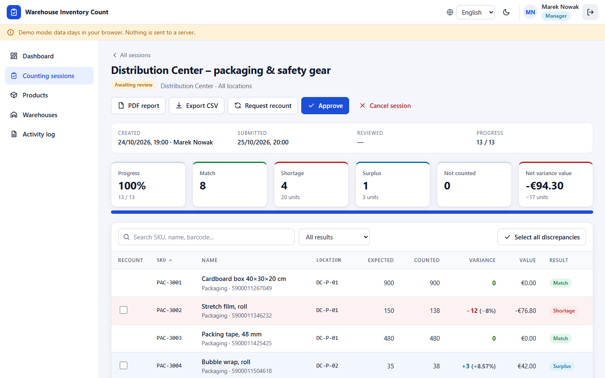

# Warehouse Inventory Count

A browser-based stock-counting application for warehouses: barcode counting sessions, discrepancy review with approve / recount workflow, PDF and CSV reports, role-based access and an installable offline-capable PWA. It is a plain static site (HTML + CSS + ES modules, no build step, no framework, no runtime dependencies), so it runs from any static file server, including GitHub Pages.

**[Live demo](https://arifaydin12.github.io/warehouse-inventory-count/)** · Languages: English (default), German, Polish


> **Demo mode: data stays in your browser.** There is no backend. All data is stored in this browser's `localStorage`; nothing is sent anywhere. Use **Reset demo data** (login page, or in the banner for admins) to restore the seeded data at any time.

| Sign-in | Counting | Review / report |
| --- | --- | --- |
|  |  |  |

## Demo accounts

Pick a user on the login screen and enter the PIN `1234` (the same for all three). These are fictional accounts.

| User | Role | What the role can do |
| --- | --- | --- |
| Anna Kowalska | Admin | Everything: users, deleting products/warehouses, resetting demo data |
| Marek Nowak | Manager | Products and warehouses (create/edit/import), create sessions, review (approve / recount), cancel, activity log |
| Piotr Zieliński | Operator | View catalogue and sessions, count items, submit a count for review, export reports |

Five wrong PINs lock the login form for 30 seconds. The PIN check happens in the browser, so this is a front-end showcase, not a hardened multi-user system (see [Limitations](#limitations)).

## Features

- **Role-based access** (admin / manager / operator) with PIN login. Routes, buttons and every state-changing action are permission-checked (`js/domain/permissions.js`, `js/core/actions.js`).
- **Warehouses and locations**: add, edit and delete warehouses and storage locations (deletion is blocked while products or active sessions use them).
- **Product catalogue**: SKU, barcode, category, unit, location, expected stock and unit cost; form validation with per-field messages; search, filter, sort and pagination.
- **Counting sessions**: a session snapshots the expected stock of a warehouse (or a single location). Count by typing/scanning a barcode or SKU in the scan field (hardware scanners behave like keyboards and end with Enter), in *add* or *set* mode with a quantity, with undo, sound feedback, inline editing of counts in the table, and "mark remaining as zero". Optional **camera scanning** appears only where the `BarcodeDetector` API exists.
- **Discrepancy calculation**: variance in units, percent and value (EUR), accuracy and progress per session.
- **Review workflow**: `open → submitted → approved`; a manager can instead request a **recount** of selected discrepancies (previous counts are kept in the line history), which sends the session back to counting for those lines only. Approving updates the expected stock of the products. Sessions can be cancelled.
- **Dashboard** with KPIs and four SVG charts (discrepancies by category, count results, items counted per day, session progress).
- **Activity / audit log** with search, filters, sorting, pagination and CSV export.
- **Import / export**: product CSV import with preview and per-row errors (comma, semicolon or tab separated; update-by-SKU), product CSV export, session CSV export, activity-log CSV export, and a **PDF report** per session generated in the browser with pdfmake (in the selected language, with signature lines).
- **Dark mode**, **language switcher** (en / de / pl), responsive layout from 360 px to 1920 px, keyboard-accessible dialogs and tables, skip link, live regions, visible focus.
- **Installable PWA**: web manifest and a service worker with relative scope, so it works at `/` and at `/warehouse-inventory-count/`; the app (including the PDF library) works offline after the first visit.
- **Seeded realistic demo data**: 3 warehouses, 12 locations, 39 products (with German and Polish names), 4 sessions covering every workflow state, an audit trail relative to the current date.

## Run it

Requires Node.js 20+ only for the tiny dev server and the tests; the app itself needs no installation.

```bash
npm start            # serves the repository at http://localhost:8080/
```

Any static server works (`npx serve .`, `python -m http.server`, GitHub Pages). Opening `index.html` directly from the file system does not work because browsers block ES modules on `file://` URLs; the page tells you so.

To check sub-path hosting like GitHub Pages: `node scripts/serve.mjs --port 8081 --base /warehouse-inventory-count/`.

## Tests

```bash
npm test             # node:test, no dependencies
```

76 unit tests cover the pure logic: discrepancy calculation, CSV parsing/export (quotes, delimiters, BOM, formula-injection guard, product import validation), role permissions, session workflow and recount handling, form validation, EAN-13 helpers, PIN hashing and login throttling, seed-data consistency, i18n completeness (identical keys and placeholders in en / de / pl, CLDR plural forms, every key used in source exists, no Turkish letters anywhere in the sources), and the PWA setup (every module is precached, manifest and service-worker version are consistent, only relative URLs, no CDN).

An optional end-to-end script drives a real browser (26 steps: logins for each role, product creation and validation, CSV import/export, a full counting → recount → approval flow, PDF/CSV downloads, language and theme switching, responsive overflow checks, accessibility basics, camera path with a stubbed detector, offline reload and sub-path service-worker scope). It needs `puppeteer-core` and a Chrome/Edge executable, which are not project dependencies:

```bash
npm start                                   # terminal 1
BROWSER_PATH=/path/to/chrome PUPPETEER_CORE=/path/to/node_modules/puppeteer-core \
  npm run test:e2e                          # terminal 2 (optionally SCREENSHOT_DIR=docs)
```

## Architecture

```
index.html                  Shell: loads css/styles.css and js/main.js (type="module")
manifest.webmanifest        PWA manifest (start_url and scope "./")
sw.js                       Service worker: precache + network-first with offline fallback
css/styles.css              All styles (CSS custom properties, light/dark themes)
js/
  main.js                   Boot: load state, start app, register service worker
  app.js                    Shell, hash router, role-aware navigation
  i18n.js, locales/         Dictionaries (en, de, pl), {param} interpolation, plurals, Intl formatting
  domain/                   Pure logic with no DOM/storage access (unit-tested)
    discrepancy.js  workflow.js  csv.js  validation.js  permissions.js  barcode.js  categories.js
  core/                     State and side effects
    store.js (state + persistence)  actions.js (permission-checked commands + audit log)
    auth.js (PIN hashing, throttling)  seed.js (demo data)  storage.js (safe localStorage wrapper)
  services/                 pdf.js (pdfmake), camera.js (BarcodeDetector), sound.js
  ui/                       dom.js (h() helper), components, table, charts (SVG), icons, views/
vendor/pdfmake/             pdfmake 0.2.7 + Roboto fonts (MIT), loaded on demand
scripts/serve.mjs           Zero-dependency static server (supports --base)
tests/unit/                 node:test suites     tests/e2e/run.cjs  optional browser test
```

Design notes:

- **No build step.** Source files are the files that run. Views build DOM with a small `h()` helper that inserts strings as text nodes only, so user data is never interpreted as HTML.
- **Domain logic is separated from the UI**, which keeps it testable in Node without a browser.
- **State** lives in one JSON document in `localStorage` (key `wic.data.v1`, versioned; unreadable data is replaced by the seed). Preferences (language, theme, sound) are stored separately and survive "Reset demo data". Several tabs stay in sync through the `storage` event.
- **Translations of data**: seeded products, warehouses and sessions carry `i18n` overrides for names; editing a name removes the overrides. Categories, units, roles and statuses are stored as ids and translated for display.
- **Dependencies**: none at runtime. The only third-party code is pdfmake 0.2.7 (MIT), vendored under `vendor/pdfmake/` so that PDF export works offline and no CDN is involved.

### CSV format

Product import/export columns: `sku, barcode, name, category, unit, location, expected, unit_cost`. Required: `sku, name, category, unit, location, expected`. `location` is a location code such as `MAIN-A-01`; `unit` is one of `pcs, box, pack, kg, l, m, pallet`; decimals may use `.` or `,`. Export writes a UTF-8 file with BOM for spreadsheet compatibility, and text cells that start with `= + - @` are prefixed with `'` to prevent formula injection.

### Adding a language

Copy `js/locales/en.js` to `js/locales/xx.js`, translate the values (plural keys use `key#one`, `key#few`, …), register it in `js/i18n.js` and `sw.js`; `npm test` fails until every key, placeholder and required plural form exists.

## Limitations

- **Demo security model**: login, roles and the audit log run in the browser and can be bypassed with developer tools. Do not store real data.
- Data exists only in one browser profile (no sync between devices); the storage quota of `localStorage` applies.
- Camera scanning needs a browser with `BarcodeDetector` (Chromium-based browsers; not Firefox or Safari). It is verified with a stubbed detector in the automated test, not with a physical camera and printed barcodes.
- The service worker uses network-first caching: updates are picked up on the next online load, and bumping `VERSION` in `sw.js` (kept equal to `package.json`, enforced by a test) refreshes the precache.
- Currency for values is fixed to EUR.

## License

[MIT](LICENSE). pdfmake is MIT-licensed too (`vendor/pdfmake/LICENSE`).
