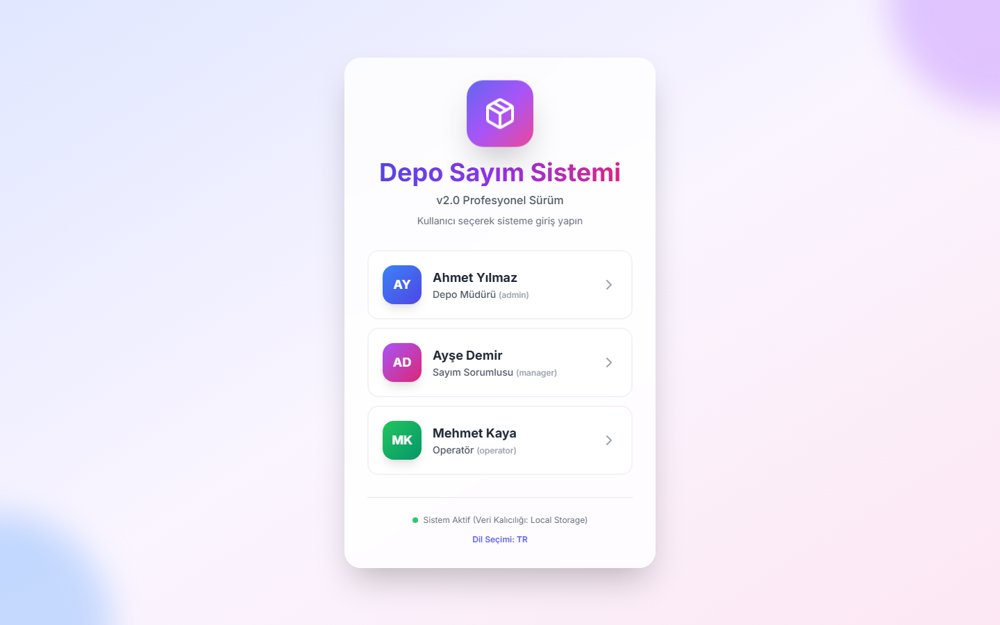

# Warehouse Inventory Count

A browser-based stock-counting application for warehouses. It has role-based access, barcode input, charts, PDF reports and three interface languages, and it works without a server because all data is stored in the browser.



**[Live demo](https://vaas125.github.io/warehouse-inventory-count/)**

## Features

- **Role-based access**: admin, manager and operator, each with different permissions
- **Inventory management**: products, stock levels and counting sessions
- **Barcode input** for hardware scanners and manual entry
- **PDF reports** generated in the browser with pdfmake
- **Statistics and charts** on the dashboard
- **Three languages**: Turkish, English and German
- **No backend required**: data is persisted client-side (IndexedDB and `localStorage`)
- Installable as a web app (manifest included) and responsive on desktop, tablet and phone

## Demo accounts

The demo ships with three sample users, all with PIN `1234`:

| User | Role |
| --- | --- |
| Ahmet Yilmaz | Admin |
| Ayse Demir | Manager |
| Mehmet Kaya | Operator |

These are fictional accounts for demonstration only. The PIN check happens in the browser, so this app is a front-end showcase and not a hardened multi-user system.

## Tech stack

React 18 (loaded from a CDN and compiled in the browser with Babel), Tailwind CSS (CDN), pdfmake, IndexedDB, `localStorage`.

## Run locally

No installation is needed. Open `index.html` in a browser, or serve the folder:

```bash
npx serve .
```

## Project structure

```
index.html              The application: UI, state, translations and storage
manifest.json           Web app manifest
config/translations.js  TR / EN / DE strings as a standalone module
database/db.js          IndexedDB wrapper as a standalone module
utils/                  Barcode-scanner and PDF helpers as standalone modules
legacy/                 Earlier single-file version (v3) kept for reference
```

The modules in `config/`, `database/` and `utils/` were extracted for a planned refactor and are not loaded by `index.html` yet.

## License

[MIT](LICENSE) © Arif Enes
